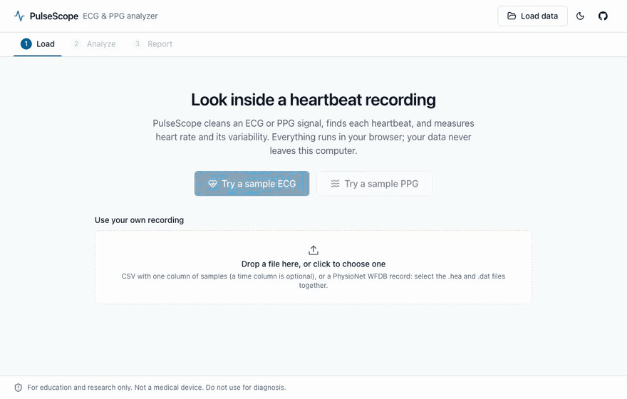
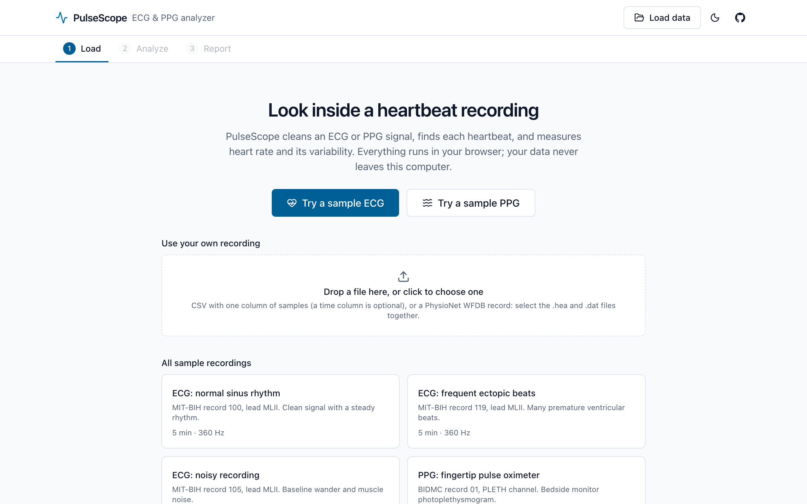
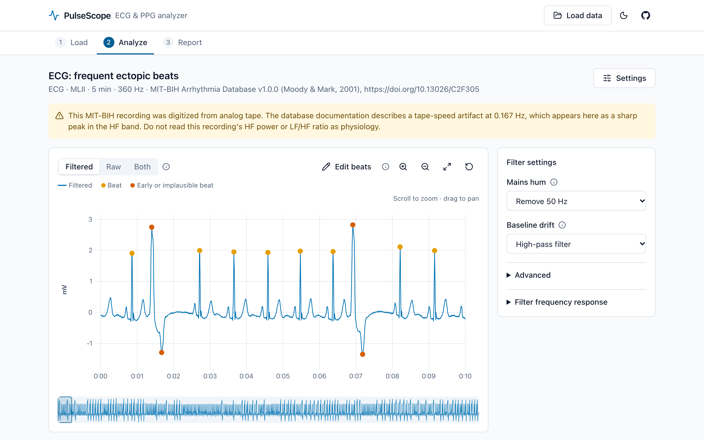
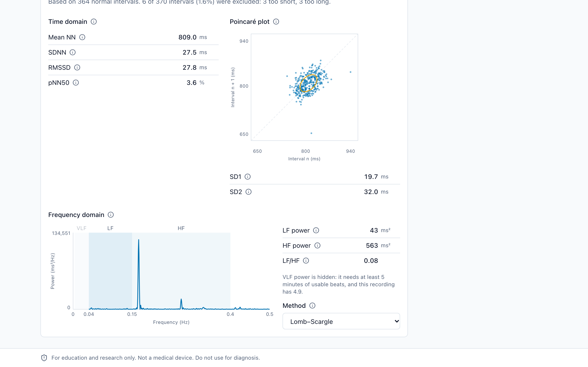
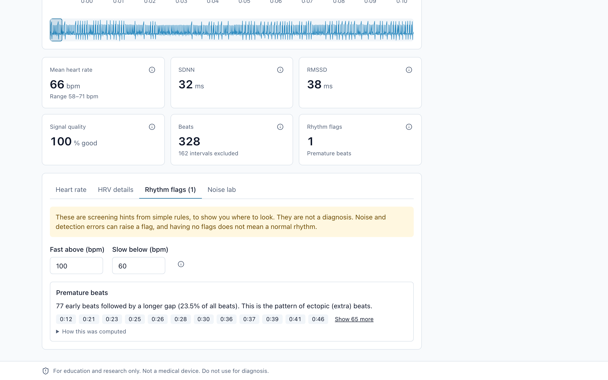
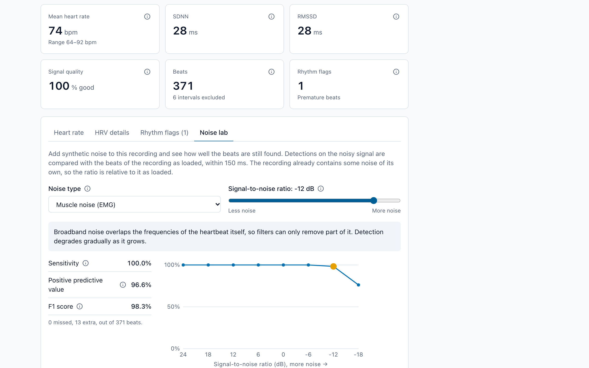
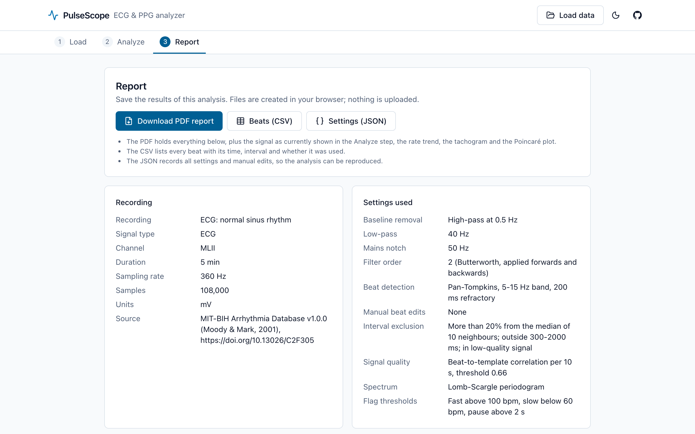
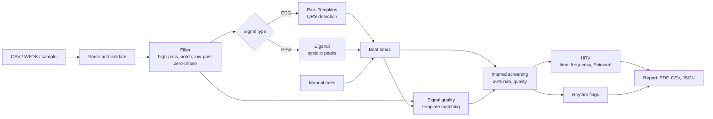

# PulseScope

**A browser-based ECG and PPG signal analyzer.** Load a recording and PulseScope cleans the signal, finds every heartbeat, measures heart rate and heart rate variability, flags a few rhythm patterns, and exports a report. Everything runs in your browser; no data leaves your computer.

**[Live demo](https://minindu-pitiduwa.github.io/ECG-PPG-Analyzer/)** · click "Try a sample ECG"

[](https://github.com/Minindu-Pitiduwa/ECG-PPG-Analyzer/actions/workflows/ci.yml)



> **For education and research only. Not a medical device. Do not use for diagnosis.**

## Why this project

The signal processing is written from scratch in TypeScript and checked against established references, with the numbers reported as measured:

| What                                              | Checked against                                            | Result                                           |
| ------------------------------------------------- | ---------------------------------------------------------- | ------------------------------------------------ |
| QRS detector (Pan–Tompkins)                       | all 48 MIT-BIH Arrhythmia records, 109,494 annotated beats | sensitivity 99.37%, positive predictivity 99.45% |
| Butterworth, notch, zero-phase and median filters | SciPy                                                      | worst difference 2e-11 across 12 filter designs  |
| HRV time domain, Poincaré, Lomb–Scargle, Welch    | NeuroKit2 and SciPy                                        | agree to 1e-9 (relative) on 4 interval series    |
| WFDB file reader                                  | the `wfdb` Python package                                  | 31,200,000 samples, 0 differences                |

## Features

|                                                                                                                                      |                                                                                                                                                 |
| ------------------------------------------------------------------------------------------------------------------------------------ | ----------------------------------------------------------------------------------------------------------------------------------------------- |
|                                                   |                                                     |
| **Load.** Bundled samples, CSV with automatic column and sampling-rate detection, or PhysioNet WFDB records (formats 212 and 16).    | **Analyze.** Zoomable plot of up to 30 minutes at 500 Hz, raw/filtered overlay, beat markers, manual beat editing with undo.                    |
|                                           |                                                                             |
| **HRV.** SDNN, RMSSD, pNN50, Poincaré SD1/SD2, LF/HF by Lomb–Scargle or Welch. Ectopic and noisy intervals are excluded and counted. | **Rhythm flags.** Fast and slow stretches, pauses, premature beats, irregular rhythm. Each says what was found, where, and how it was computed. |
|                                                    |                                                                                     |
| **Noise lab.** Add baseline wander, mains hum, muscle noise or motion artifacts at a chosen SNR and watch detection accuracy change. | **Report.** PDF with plots and all metrics, a CSV of beats and intervals, and a JSON of every setting for reproducibility.                      |

Also: a signal quality index that greys out unreliable segments, a plain-language tooltip on every metric and setting, light and dark themes, keyboard control of the plot, and a layout that works down to phone width.

## How it works



**Filtering.** Butterworth filters are designed with the bilinear transform and pre-warping, and run as cascaded second-order sections, because a single high-order polynomial is numerically fragile for cutoffs as low as 0.5 Hz. Filtering is zero-phase (forwards, then backwards, with the edge handling of Gustafsson [8]), so no waveform feature is shifted in time; the price is that the magnitude response applies twice. Defaults are 0.5–40 Hz for ECG and 0.5–8 Hz for PPG, plus a 50 or 60 Hz notch. A two-stage median filter [9] is the alternative baseline remover.

**ECG beat detection: Pan–Tompkins [1].** A 5–15 Hz band-pass isolates QRS energy; differentiating, squaring and integrating over 150 ms turns each QRS into one bump. Two sets of adaptive thresholds, on the integrated and on the band-passed signal, decide which bumps are beats. A 200 ms refractory period, a slope test that rejects T waves, and a search-back for beats missed when none arrives within 166% of the expected interval complete the logic. The decision rules and their coefficients are the paper's. Two things are adapted: the paper's integer filters are fixed to 200 Hz, so a Butterworth band-pass and a rate-scaled derivative are used instead, and because analysis is offline the filters are zero-phase, which removes the paper's delay bookkeeping.

**PPG beat detection: Elgendi et al. [2].** A short moving average (111 ms, one systolic peak) is compared with a long one (667 ms, one beat) of the squared, clipped signal. Where the short one is higher there is a pulse, and its maximum is the systolic peak. Both averages follow the local amplitude, which a fixed threshold cannot.

**Beat timing.** Each peak is refined by fitting a parabola through its three highest samples, so beat times are finer than one sample. At 125 Hz a sample is 8 ms, as large as real differences in RMSSD.

**Interval screening.** HRV describes the sinus rhythm, so intervals that are not normal-to-normal are excluded: more than 20% from the median of their ten neighbours, outside 300–2000 ms, or in low-quality signal. Successive differences are never formed across an excluded interval.

**HRV [3].** Time domain: mean NN, SDNN, RMSSD, pNN50. Frequency domain: the Lomb–Scargle periodogram [4] works on the unevenly spaced beats directly and tolerates the gaps left by exclusions; Welch's method [13] on a 4 Hz resampling is the classical alternative. LF and HF are shown from 2 minutes of usable beats and VLF from 5; below that the app says why they are hidden. Poincaré SD1 and SD2 follow Brennan et al. [5].

**Signal quality [6].** Within each 10-second segment the beats are averaged into a template and each beat is correlated with it. Real beats repeat their shape; noise does not.

**Rhythm flags.** Simple, explainable rules. The irregular-rhythm rule combines normalized RMSSD with the coefficient of sample entropy [7], which separates the unpredictable irregularity of atrial fibrillation from patterned rhythms such as bigeminy.

## Validation

### QRS detection on the MIT-BIH Arrhythmia Database

All 48 records, first channel, beat annotations only, 150 ms tolerance (ANSI/AAMI EC57), whole record with no learning period excluded. Sensitivity is TP / (TP + FN), positive predictivity is TP / (TP + FP). NeuroKit2 [14] was run on the same signals and scored by the same code.

| Detector                                          |      TP |    FP |    FN |      Se % |     PPV % |      F1 % |
| ------------------------------------------------- | ------: | ----: | ----: | --------: | --------: | --------: |
| **PulseScope Pan–Tompkins (TypeScript)**          | 108,806 |   599 |   688 | **99.37** | **99.45** | **99.41** |
| NeuroKit2 0.2.13, method `neurokit` (its default) | 108,254 | 1,899 | 1,240 |     98.87 |     98.28 |     98.57 |
| NeuroKit2 0.2.13, method `pantompkins1985`        | 108,858 |   949 |   636 |     99.42 |     99.14 |     99.28 |

Without the four records that contain paced beats (102, 104, 107, 217), PulseScope scores Se 99.33%, PPV 99.41%, F1 99.37% on the remaining 44.

Switching off parts of the algorithm shows what they contribute:

| Variant                  |    FP |  FN |  F1 % |
| ------------------------ | ----: | --: | ----: |
| Complete                 |   599 | 688 | 99.41 |
| Without the T-wave check | 1,071 | 663 | 99.21 |
| Without search-back      |   582 | 951 | 99.30 |

The full per-record table is in [validation/benchmark/results/results.md](validation/benchmark/results/results.md), generated by the benchmark script.

### Where it fails

Two records, 114 and 207, produce about two thirds of all errors (868 of 1,287).

- **Record 114** (423 of the 688 missed beats). Its first channel is V5, with small QRS complexes; 420 of the missed beats are annotated as normal. In the 5–15 Hz band the complexes fall below the adaptive threshold. During development a 5–20 Hz band recovered almost all of them (9 missed) and raised the overall score, but the band was kept at the paper's 5–15 Hz: choosing parameters by their score on the test database would make the benchmark meaningless.
- **Record 207** (371 of the 599 extra detections). 368 of them fall inside episodes annotated as ventricular flutter. Flutter waves are not annotated as beats, so every detection there counts as false, although the detector is responding to real ventricular activity.
- **Record 222.** 29 of its 33 extra detections occur during atrial flutter, where flutter waves are large enough to pass as QRS complexes.
- **Record 201.** 27 of its 28 missed beats are aberrated atrial premature beats: early, small, and below the threshold that the preceding normal beats set.
- **Record 105.** 42 extra detections in a recording with heavy noise and baseline shifts, all in stretches annotated as normal rhythm.
- **Wide ventricular beats.** The T-wave check compares slopes. A wide ectopic beat has a gentle slope, so the T wave that follows it can pass the check. This causes the two extra detections on the bundled "frequent ectopic beats" sample.

### Other checks

- **Irregular-rhythm rule.** On the reference beats of MIT-BIH, in 30-interval windows, it flags 314 of 319 atrial-fibrillation windows (98.4%) and leaves 2,483 of 2,752 other windows alone (90.2%). It also flags 92% of atrial-flutter windows and 44% of bigeminy windows. Its two thresholds are this project's choice and were not tuned on these results. The app requires 30 seconds of such windows before raising a flag; that stricter rule has not been scored separately.
- **PPG detector.** The BIDMC dataset has no beat annotations. On the bundled sample the median pulse rate is within 1 bpm of the bedside monitor's 91.3 bpm. That is a sanity check, not a benchmark.
- **Filters and HRV.** Reference outputs from SciPy and NeuroKit2 are stored in `tests/fixtures/` and compared in the unit tests at a stated tolerance of 1e-9. Two HRV measures are defined slightly differently from NeuroKit2 on purpose (pNN50 divides by the number of differences, SD2 is measured directly); the tests explain and check the relation.

## Tech stack and architecture

React 19, TypeScript (strict), Vite, Tailwind CSS, Zustand, uPlot, Radix UI primitives, jsPDF. Tests with Vitest and Playwright. Python (NumPy, SciPy, wfdb, NeuroKit2) is used only to generate reference values and is not needed to run the app.

```
src/dsp/         signal processing: pure TypeScript, no browser or React imports
  filters/       Butterworth, notch, zero-phase filtering, median baseline
  detect/        Pan–Tompkins, Elgendi, peak refinement, manual beat edits
  hrv/           interval screening, time domain, frequency domain, Poincaré
  quality/       template-matching signal quality index
  rhythm/        sample entropy, rhythm flags
  noise/         noise generators and the noise experiment
src/io/          CSV and WFDB readers, sample loader, CSV export
src/workers/     Web Worker: filtering and detection run off the UI thread
src/store/       Zustand stores (recording, settings, analysis, beat edits, view)
src/features/    the Load, Analyze and Report screens
src/components/  shared UI and plot components
tests/           unit tests and reference fixtures
e2e/             Playwright tests against the production build
validation/      Python reference generators and the benchmark scripts
```

Design decisions worth knowing:

- **The DSP core is portable.** A lint rule forbids `src/dsp/` from importing React or touching the DOM, so the same code runs in the browser worker, in the unit tests and in the Node benchmark.
- **Heavy work is off the main thread; cheap work is not.** Filtering and detection process millions of samples and run in a worker. Metrics are derived from a few thousand beat times on the main thread, so a manual beat edit updates everything at once.
- **Plots never hold the whole recording.** The visible window is reduced to the minimum and maximum of each pixel column, which keeps every R-peak at its true height at any zoom. LTTB was the original plan; min/max is cheaper and cannot drop a peak.
- **Manual edits are stored as edits, not as a beat list.** They are replayed on top of the detections, so they survive a change of filter settings.
- **Screen and PDF share one report model**, so they cannot disagree.

## Run it locally

Requires Node.js 22 or newer.

```bash
npm install
npm run dev
```

### Tests

```bash
npm run lint         # ESLint
npm run typecheck    # TypeScript, strict mode
npm test             # 357 unit tests (Vitest)
npm run build        # production build
npx playwright install chromium   # once
npx playwright test  # 13 end-to-end tests against the production build
```

### Benchmark

The Python environment is only needed here and for regenerating fixtures.

```bash
python3 -m venv validation/.venv
validation/.venv/bin/pip install -r validation/requirements.txt

validation/.venv/bin/python validation/benchmark/export_mitdb.py   # downloads ~100 MB once
validation/.venv/bin/python validation/benchmark/run_neurokit.py   # NeuroKit2 detections
npm run benchmark                                                  # scores everything, writes results/

npx tsx validation/benchmark/run_irregular.ts   # irregular-rhythm rule
npx tsx validation/benchmark/check_wfdb.ts      # WFDB reader, all 48 records
```

Reference fixtures and README media are regenerated with `validation/gen_fixtures.py`, `gen_hrv_fixtures.py`, `gen_sample_refs.py`, `gen_wfdb_fixtures.py`, `make_samples.py` and `npm run docs:capture`.

## Limitations

- **Not a medical device.** Nothing here has been clinically validated. The rhythm flags are screening hints from simple rules; noise and detection errors raise them, and their absence does not mean a normal rhythm.
- **One benchmark database.** MIT-BIH is the standard, but it is 48 half-hour recordings from the 1970s. Performance on wearable or single-lead hobby hardware will differ.
- **The PPG path is less validated than the ECG path**, for lack of annotated data. Values from PPG are pulse rate variability, which approximates HRV at rest only.
- **MIT-BIH tapes carry a known artifact.** The database documentation describes a tape-speed artifact at 0.167 Hz. It appears as a sharp HF peak in the bundled ECG samples, so their HF power and LF/HF ratio are not physiological. The app shows this caution when such a sample is loaded.
- **One lead at a time**, single-segment WFDB records in formats 16 and 212 only, and CSV without quoted fields.
- **Offline only.** Zero-phase filtering needs the whole recording.
- **Typical ranges in the tooltips** are rough guides for healthy adults at rest, not reference limits.

## Data licenses

The code is MIT-licensed. The sample recordings in `public/samples/` are excerpts of the MIT-BIH Arrhythmia Database [10] and the BIDMC PPG and Respiration Dataset [11] from PhysioNet [12], both under the Open Data Commons Attribution License v1.0. Details and citations are in [DATA_LICENSES.md](DATA_LICENSES.md).

## Roadmap

- Live streaming from hardware (AD8232, MAX30102) over Web Serial; the input layer already produces one `Recording` type for every source
- Import of a settings JSON to re-apply an analysis
- Multi-lead display and lead comparison
- More WFDB formats and multi-segment records
- Benchmarks on further databases (MIT-BIH Atrial Fibrillation, a PPG set with beat annotations)
- Keyboard-accessible beat editing
- A learned beat classifier as an optional, clearly separated module

## References

1. Pan J, Tompkins WJ. A real-time QRS detection algorithm. _IEEE Trans Biomed Eng._ 1985;32(3):230–236.
2. Elgendi M, Norton I, Brearley M, Abbott D, Schuurmans D. Systolic peak detection in acceleration photoplethysmograms measured from emergency responders in tropical conditions. _PLoS ONE._ 2013;8(10):e76585.
3. Task Force of the European Society of Cardiology and the North American Society of Pacing and Electrophysiology. Heart rate variability: standards of measurement, physiological interpretation, and clinical use. _Circulation._ 1996;93(5):1043–1065.
4. Lomb NR. Least-squares frequency analysis of unequally spaced data. _Astrophys Space Sci._ 1976;39:447–462. Scargle JD. Studies in astronomical time series analysis II. _Astrophys J._ 1982;263:835–853. Laguna P, Moody GB, Mark RG. Power spectral density of unevenly sampled data by least-square analysis. _IEEE Trans Biomed Eng._ 1998;45(6):698–715.
5. Brennan M, Palaniswami M, Kamen P. Do existing measures of Poincaré plot geometry reflect nonlinear features of heart rate variability? _IEEE Trans Biomed Eng._ 2001;48(11):1342–1347.
6. Orphanidou C, Bonnici T, Charlton P, Clifton D, Vallance D, Tarassenko L. Signal-quality indices for the electrocardiogram and photoplethysmogram: derivation and applications to wireless monitoring. _IEEE J Biomed Health Inform._ 2015;19(3):832–838.
7. Lake DE, Moorman JR. Accurate estimation of entropy in very short physiological time series: the problem of atrial fibrillation detection in implanted ventricular devices. _Am J Physiol Heart Circ Physiol._ 2011;300(1):H319–H325.
8. Gustafsson F. Determining the initial states in forward-backward filtering. _IEEE Trans Signal Process._ 1996;44(4):988–992.
9. de Chazal P, O'Dwyer M, Reilly RB. Automatic classification of heartbeats using ECG morphology and heartbeat interval features. _IEEE Trans Biomed Eng._ 2004;51(7):1196–1206.
10. Moody GB, Mark RG. The impact of the MIT-BIH Arrhythmia Database. _IEEE Eng Med Biol._ 2001;20(3):45–50.
11. Pimentel MAF, Johnson AEW, Charlton PH, et al. Toward a robust estimation of respiratory rate from pulse oximeters. _IEEE Trans Biomed Eng._ 2017;64(8):1914–1923.
12. Goldberger AL, Amaral LAN, Glass L, et al. PhysioBank, PhysioToolkit, and PhysioNet. _Circulation._ 2000;101(23):e215–e220.
13. Welch PD. The use of fast Fourier transform for the estimation of power spectra. _IEEE Trans Audio Electroacoust._ 1967;15(2):70–73.
14. Makowski D, Pham T, Lau ZJ, et al. NeuroKit2: a Python toolbox for neurophysiological signal processing. _Behav Res Methods._ 2021;53:1689–1696.

## License

[MIT](LICENSE). Sample data keeps its own license.
